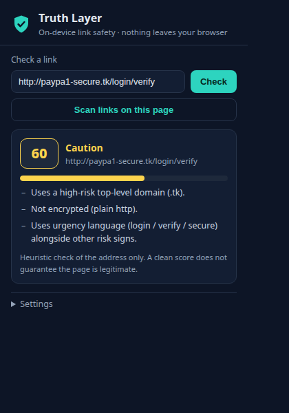

# Truth Layer

[](LICENSE)
[](manifest.json)
[](tests/run.js)
[](src/)



A browser extension that protects you from phishing links and synthetic media — running 100% on-device. No URL, image, or page content ever leaves your browser. There is no backend, no analytics, no remote config.

## What it does

- **Link safety verdicts** — score any URL 0–100 with plain-language reasons (punycode disguise, typosquatting, brand-as-subdomain tricks, IP hosts, URL shorteners, high-risk TLDs, credential-redirect `@` tricks, missing HTTPS). Bands: Looks safe / Caution / Suspicious / Dangerous.
- **On-page link badging** — risky links get a warning badge with a hover tooltip explaining why.
- **Right-click tools** — "Check link safety" on any link; "Analyze image" and "Check video provenance" on any media.
- **Media analyzer panel** — reads embedded C2PA provenance manifests (issuing tool, dates) when present, scans EXIF/PNG metadata for AI-generator tags, and links out to reverse-image search. States its limits up front: AI detection without provenance is probabilistic, and "no signs found" is never presented as "authentic."

## Install (developer mode)

1. Clone or download this repo.
2. Open `chrome://extensions`, enable **Developer mode**.
3. Click **Load unpacked** and select the `truth-layer/` folder.
4. Pin Truth Layer to the toolbar. Test it on `qa/phishing-samples.html` (open the file in Chrome).

## Project structure

```
manifest.json                  # MV3, minimal permissions
src/background/service-worker.js
src/content/link-scanner.js    # on-page badging (MutationObserver for dynamic content)
src/popup/                     # verdict UI: paste URL, scan page, settings
src/analyzer/                  # forensic panel for images/video
src/lib/
  url-heuristics.js            # pure scoring engine (also used by tests)
  domain-lists.js              # popular domains, shorteners, risky TLDs, AI tags
  metadata.js                  # EXIF / PNG text-chunk reader
  c2pa.js                      # C2PA/JUMBF manifest detection
icons/                         # generated by tools/make-icons.js (pure node, no deps)
tests/run.js                   # 17 unit tests, plain node assert
qa/phishing-samples.html       # labeled safe/tricky fixture links (not part of the extension)
```

## Development notes

- Zero npm dependencies in the extension itself. `lib/` files are pure functions with no `chrome.*` calls, so the same code runs in the service worker, content scripts, popup, and plain node tests.
- Run tests: `node tests/run.js` (exits non-zero on failure).
- Privacy architecture: the only network the extension makes is fetching image bytes the browser already loaded, for local C2PA/metadata analysis.

## Limitations

Heuristics catch bulk phishing, not targeted spear-phishing — a clean score is not proof of legitimacy (stated in the UI). C2PA reading detects manifest presence; it does not validate signatures. Sites without CORS headers block cross-origin image fetch, so the analyzer includes a file-upload fallback.

## License

MIT — see [LICENSE](LICENSE).
